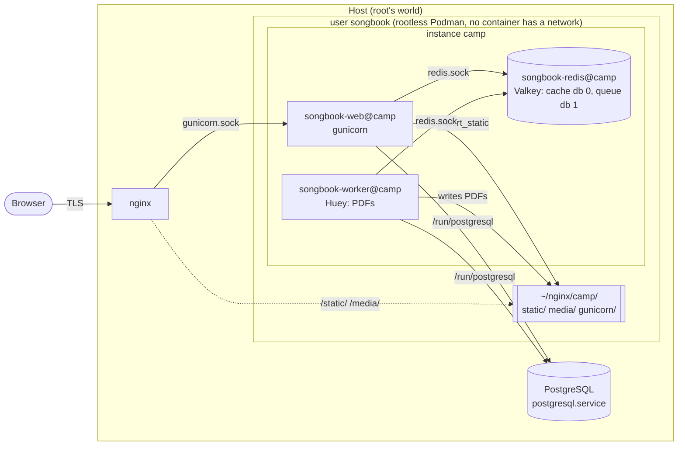
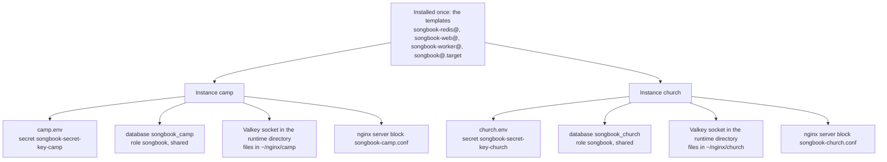

# Deploying with Podman quadlets

This guide runs the songbook as **user-level** systemd services (`systemctl --user`) generated by
Podman [quadlets](https://docs.podman.io/en/latest/markdown/podman-systemd.unit.5.html), behind an
nginx and a PostgreSQL that are installed **on the host**. Every component talks over **unix sockets**;
none of the containers has a network (`Network=none`). Root is needed for section 1, the PostgreSQL role and
database, the SELinux modules and the nginx configuration; everything else runs as the service user. A host
without a PostgreSQL of its own can run one in a container instead, see
[PostgreSQL in a container](#8-postgresql-in-a-container).

The units are systemd **templates**: one set of files serves any number of independent songbooks
(*instances*) under the same user. Each instance has its own name — `camp` in the examples — which
systemd substitutes for `%i` in the unit files, and its own database, Valkey, secrets, env file, sockets and
static/media directories. The cache and queue server is Valkey; its unit, container, volume and socket keep the
name `redis`, which is what Django and Huey call the protocol. Commands below use `$INSTANCE`, so
`export INSTANCE=camp` first.



Everything that crosses a box is a unix socket or a file; nothing listens on a port.

| Unit (all `…@<instance>`) | Image | Role |
|---|---|---|
| `songbook@.target` | — | the instance as a whole: starts web and worker at boot, stops and restarts all its units |
| `songbook-redis@` | `valkey/valkey:8` | Django cache (db 0) and Huey queue (db 1), socket in `$XDG_RUNTIME_DIR/songbook/<instance>/redis` |
| `songbook-web@` | `ghcr.io/pehala/song-book` | `make migrate prerender cache_clear export_static start`: waits for PostgreSQL, brings the database, cache and nginx's static files up to date, then runs gunicorn on `~/nginx/<instance>/gunicorn` |
| `songbook-worker@` | `ghcr.io/pehala/song-book` | `make worker`: Huey consumer that renders PDFs |

The guide assumes a dedicated, unprivileged user — `songbook` with home `/home/songbook` in the
examples — a recent Podman (the units are written against 5.x), and the nginx and PostgreSQL packages of
the host. All files referenced live in `deploy/`; run the commands from a checkout of the repository.

## 1. Prepare the host (as root, once)

```bash
useradd --create-home songbook
loginctl enable-linger songbook              # start the user's services at boot, without a login
setfacl -m u:www-data:x /home/songbook       # nginx may traverse the home, nothing more (Fedora, RHEL: u:nginx)
```

The home directory stays private (`0700`); the ACL only lets nginx *pass through* it to `~/nginx`.
With SELinux enforcing, also see [Permissions and SELinux](#permissions-and-selinux) and the PostgreSQL
module in the next section.

Everything else runs as `songbook`. Log in with `machinectl shell songbook@` (or SSH) rather than
`su`, so that `systemctl --user` finds the user's session.

## 2. PostgreSQL

The containers use the server's socket in `/run/postgresql`, which the units mount as it is. Because they run
with `UserNS=keep-id`, a connection arrives as the host user `songbook`, and PostgreSQL's `peer` authentication maps
it to the role of the same name, **without a password**. Distributions ship `local all all peer` in `pg_hba.conf`,
so the defaults need no change. Each instance gets a database of its own; instances may share the role.

**Role and database (as root; the role once, a database per instance).** The role carries the name of the host user:

```bash
sudo -u postgres psql <<'SQL'
CREATE ROLE songbook LOGIN;
CREATE DATABASE songbook_camp OWNER songbook;
SQL
```

Skip `CREATE ROLE` if it exists. A database that the app used before works as it is, see
[migrating](#7-migrating-an-existing-deployment). Check it as `songbook`:

```bash
psql songbook_camp --command 'SELECT current_user'
```

**SELinux (as root, only when enforcing).** A container may not connect to PostgreSQL's socket by
default. Install [`selinux/songbook_postgres.te`](selinux/songbook_postgres.te) like the nginx module in
[Permissions and SELinux](#permissions-and-selinux):

```bash
cd deploy/selinux
checkmodule -M -m -o songbook_postgres.mod songbook_postgres.te
semodule_package -o songbook_postgres.pp -m songbook_postgres.mod
semodule -i songbook_postgres.pp
```

The directory is mounted without `:z` on purpose: relabelling `/run/postgresql` would change it for every
other client of the server.

### Locating the socket

Only needed when the server is not on the defaults. The socket is `<directory>/.s.PGSQL.<port>`, and the port is
part of its name.

```bash
sudo -u postgres psql --command 'SHOW unix_socket_directories'      # /var/run/postgresql is /run/postgresql
pg_lsclusters                                                       # Debian, Ubuntu: one cluster per major version
ls -la /run/postgresql/                                             # .s.PGSQL.5432, .s.PGSQL.5433, …
```

- **Another port** (the database is on the second cluster, 5433, and so on): set `POSTGRES_PORT` in the env file of the
  instance. Without it the app tries 5432 and finds another database, or none.
- **Another directory:** change the path in the `Volume=` line of `songbook-web@.container` and
  `songbook-worker@.container` and in the `ExecStartPre=` of web, before
  [installing them](#4-install-the-units-and-start).

### A role with a password

If `pg_hba.conf` does not use `peer` for `local` connections, or the role must have a password for another reason,
create it (`CREATE ROLE songbook LOGIN PASSWORD '…'`), put `local songbook songbook scram-sha-256` above the
catch-all rule, store the password as a secret and hand it to the units with a drop-in, once per template. The
directory is the one the templates are installed into in [section 4](#4-install-the-units-and-start):

```bash
printf '%s' 'the password' | podman secret create songbook-db-password-$INSTANCE -
for unit in web worker; do
  mkdir -p ~/.config/containers/systemd/songbook/songbook-$unit@.container.d
  printf '[Container]\nSecret=songbook-db-password-%%i,type=env,target=POSTGRES_PASSWORD\n' \
    > ~/.config/containers/systemd/songbook/songbook-$unit@.container.d/password.conf
done
```

## 3. Prepare an instance

Directories for Valkey's socket and for the served files, one tmpfiles file per instance:

```bash
export INSTANCE=camp
mkdir -p ~/.config/user-tmpfiles.d
sed "s/INSTANCE/$INSTANCE/g" deploy/user-tmpfiles.d/songbook.conf > ~/.config/user-tmpfiles.d/songbook-$INSTANCE.conf
systemd-tmpfiles --user --create
```

Valkey's socket goes to `$XDG_RUNTIME_DIR/songbook/<instance>` (`/run/user/<uid>`, private to the user, recreated at
every boot by the same file); what nginx reads goes to `~/nginx/<instance>`.

Configuration and secrets:

```bash
install -D -m 0600 deploy/songbook.env.example ~/.config/songbook/$INSTANCE.env
nano ~/.config/songbook/$INSTANCE.env        # an editor by name: $EDITOR is often empty

python3 -c 'import secrets; print(secrets.token_urlsafe(50), end="")' | podman secret create songbook-secret-key-$INSTANCE -
```

In the env file, set at least:

- `ALLOWED_HOSTS` to **every tenant hostname**, and `CSRF_TRUSTED_ORIGINS` to the same as `https://` origins.
  Adding a tenant later means adding its host to both and to nginx `server_name`.
- `TENANT_HOSTNAME`, the default tenant that the first migration creates.
- `POSTGRES_DB`, the database of the instance (`songbook_camp` above; the default is `songbook`), and
  `POSTGRES_PORT` if the cluster is not on 5432 (`POSTGRES_USER` too, if the role is not `songbook`).
- optionally `SONG_RENDERER` (`chords.markdown.RUBY_RENDERER` draws the chords above the words), `TIME_ZONE`,
  `TENANT_NAME` and the timings and log level listed, commented out with their defaults, in the example file.

The file is also read by systemd, so write values without quotes. Any other setting can be changed by editing
[`chords/settings/container.py`](../chords/settings/container.py) and rebuilding.

If the database already holds a songbook, restore or adopt it **before** the first start: web would otherwise
migrate an empty database and create a default tenant that collides with the existing one
([migrating](#7-migrating-an-existing-deployment)).

## 4. Install the units and start

The templates are installed once for all instances:

```bash
install -D -m 0644 -t ~/.config/containers/systemd/songbook deploy/quadlets/*
install -D -m 0644 -t ~/.config/systemd/user deploy/systemd/songbook@.target
podman pull docker.io/valkey/valkey:8 ghcr.io/pehala/song-book:latest      # a private package needs `podman login ghcr.io` first
systemctl --user daemon-reload
systemctl --user enable --now songbook@$INSTANCE.target
journalctl --user -u songbook-web@$INSTANCE -f       # wait for "Listening at: unix:/run/gunicorn/gunicorn.sock"
```

Quadlet also reads subdirectories of `~/.config/containers/systemd`, and the directory name is not part of the
unit name, so the files may be kept together under `songbook`. The generator prints the units that the templates
produce: `/usr/libexec/podman/quadlet --user --dryrun` (Debian, Ubuntu: `/usr/lib/podman/quadlet`). The target
`songbook@.target` is an ordinary systemd unit, so `enable` works on it (it is refused for the generated
container units themselves): it starts the instance's web and worker now and at boot, and `stop` or `restart`
of the target act on all of its units.

Starting web pulls in Valkey, which reports ready through its health check, and waits for PostgreSQL's
socket. Web itself reports ready once gunicorn has created its socket — after the migrations — and only then does
the worker start. The user lingers, so everything comes back after a reboot. Logs go to the user's journal.

```mermaid
sequenceDiagram
    participant T as songbook@camp.target
    participant R as songbook-redis@camp
    participant P as PostgreSQL (host)
    participant W as songbook-web@camp
    participant K as songbook-worker@camp

    T->>W: start (Wants)
    W->>R: start (Requires)
    R-->>W: healthy (valkey-cli ping)
    W->>W: remove the old gunicorn.sock
    W->>P: wait for postgres/.s.PGSQL.PORT
    W->>P: migrate
    W->>W: prerender, cache_clear, export_static
    W->>W: gunicorn creates gunicorn.sock
    W-->>K: healthy (test -S gunicorn.sock)
    T->>K: start (Wants; the worker Requires and is After web)
```

Create the first superuser (not needed when you restored a database):

```bash
podman exec -it songbook-web-$INSTANCE python manage.py createsuperuser
```

Then set up nginx ([section 5](#5-nginx)).

### Adding another instance



Repeat the database of [section 2](#2-postgresql), [section 3](#3-prepare-an-instance) and
`enable --now songbook@<instance>.target` with a new `INSTANCE`, and install another nginx server block. The
templates are not copied again. Instances share nothing but the images and the user, so each one upgrades, restarts
and is backed up on its own.

## 5. nginx

As root. Install [`deploy/nginx/songbook-common.conf`](nginx/songbook-common.conf) once into
`/etc/nginx/conf.d/`: the static cache map and the catch-all default server. Then install
[`deploy/nginx/songbook.conf`](nginx/songbook.conf) (nginx 1.25.1+ for `http2 on`) once per instance, edit it and
reload:

```bash
install -m 0644 deploy/nginx/songbook-common.conf /etc/nginx/conf.d/
sed "s/INSTANCE/$INSTANCE/g" deploy/nginx/songbook.conf > /etc/nginx/conf.d/songbook-$INSTANCE.conf
nano /etc/nginx/conf.d/songbook-$INSTANCE.conf          # server_name, certificates, /home/songbook
nginx -t && systemctl reload nginx
curl -sI https://songs.example.org/api/songs | head -1    # expect HTTP/2 200
```

Set `server_name` to all of the instance's tenant hostnames, point the certificate paths at yours and replace
`/home/songbook` if the user's home differs. A `502` or `403` at this point is a permission problem, see
[Permissions and SELinux](#permissions-and-selinux) just below and the [troubleshooting table](#troubleshooting).
Highlights:

- `proxy_pass` goes to an upstream on `unix:/home/songbook/nginx/<instance>/gunicorn/gunicorn.sock`.
- `Host` is passed through untouched: the tenant is chosen from it, and an unknown host is a 404.
- `X-Forwarded-Proto` tells Django the request was HTTPS (`SECURE_PROXY_SSL_HEADER`); the container
  settings mark session and CSRF cookies `Secure`, so the site has to be served over HTTPS.
- A catch-all `default_server` drops requests for hostnames that are not tenants (`return 444`, and
  `ssl_reject_handshake` for unknown TLS names). Remove it from `songbook-common.conf` if the host already has a default server.
- `/static/` and `/media/` are served by nginx straight from `/home/songbook/nginx/<instance>`. Django does not
  serve either with `DEBUG = False`.

### Permissions and SELinux

nginx needs three things from the `songbook` user's files, all of which the setup above gives it:

- search (`x`) permission on `/home/songbook` — the ACL from section 1; nothing in the home is listable;
- `~/nginx` and everything below it world-readable (`0755` directories, `0644` files);
- the gunicorn socket writable: gunicorn creates it `0777` (`umask = 0`). Only users that can traverse
  the home — `songbook` and nginx — can reach it.

With SELinux enforcing, the `:z` volume option labels the shared directories `container_file_t` so
the containers can use them; the host's nginx (`httpd_t`) is not allowed to read that label, to
connect to a container's socket, or to enter a home directory by default. As root, allow the home
directory and install the small policy module in
[`deploy/selinux/songbook_nginx.te`](selinux/songbook_nginx.te):

```bash
setsebool -P httpd_enable_homedirs 1
cd deploy/selinux
checkmodule -M -m -o songbook_nginx.mod songbook_nginx.te
semodule_package -o songbook_nginx.pp -m songbook_nginx.mod
semodule -i songbook_nginx.pp
```

If nginx logs `Permission denied` anyway, `ausearch -m avc -ts recent | audit2allow` shows what is
still missing.

### Compression

There are two kinds of content, and they are compressed differently.

**Static files: pre-compressed, never on the fly.** They are compressed once at image build time at
the highest levels — far smaller than nginx would produce per request, at zero runtime CPU.
`brotli_static on` / `gzip_static on` make nginx look for `file.css.br` / `file.css.gz` and send it
when the client's `Accept-Encoding` allows, falling back to the plain file. Do not add
`brotli on`/`gzip on` with static types *in the static location* expecting a gain — the `_static`
lookup already wins. Images, `woff`/`woff2` fonts and PDFs are already compressed and are skipped.

**Dynamic responses: compressed by nginx, not by Django.** The page shell is small; the response that
matters is the songs JSON (`/api/songs`), which carries every song's
rendered HTML and is very repetitive — it typically shrinks 5–10×. Use moderate levels
(`brotli_comp_level 4–6`, `gzip_comp_level 4–6`): higher levels cost a lot of CPU for a few percent.
Keep Django's `GZipMiddleware` off; compressing in nginx keeps gunicorn workers free.
`gzip_proxied any` is needed so that clients behind another proxy (which send `Via`) still get
compressed responses, and `gzip_vary on` adds `Vary: Accept-Encoding` so caches keep the variants apart.

**ETags survive compression.** The JSON views send a strong ETag and `Cache-Control: no-cache`, so a
returning browser revalidates and gets a `304` with no body. When nginx compresses a response it
downgrades the ETag to a weak one (`W/"…"`); Django compares `If-None-Match` weakly, so the 304
still works. Check it after deploying:

```bash
etag=$(curl -sI -H 'Accept-Encoding: br' https://songs.example.org/api/songs | grep -i '^etag' | cut -d' ' -f2- | tr -d '\r')
curl -s -o /dev/null -w '%{http_code}\n' -H 'Accept-Encoding: br' -H "If-None-Match: $etag" https://songs.example.org/api/songs
# expect 304
```

and that statics come pre-compressed (look for `content-encoding: br` and a long `cache-control`):

```bash
curl -sI -H 'Accept-Encoding: br, gzip' https://songs.example.org/static/<path printed in the page source>
```

**No brotli module?** It is not part of stock nginx. Debian/Ubuntu ship it as
`libnginx-mod-http-brotli-filter` and `libnginx-mod-http-brotli-static`; elsewhere it may need to be
built ([google/ngx_brotli](https://github.com/google/ngx_brotli)). Without it, delete the `brotli*`
lines: gzip alone still serves the pre-built `.gz` files and compresses the JSON.

### Caching headers

- Fingerprinted statics (`styles.3f2a9c1b7d0e.css`) are `immutable` with a one-year `max-age`; their
  name changes whenever their content does. The `map` in the config tells them apart from the
  un-fingerprinted copies `collectstatic` also writes, which only get an hour.
- `/media/` is `no-cache`: a category's PDF is regenerated under the same file name.
- Dynamic pages and JSON carry the headers Django sets; do not override them in nginx.

### Slow clients

The site is meant for camps with a bad connection, so a download can take a long time. A gunicorn
thread would be blocked for all of it, which is why `proxy_buffering` stays **on**: nginx takes the
whole response from gunicorn in a few milliseconds and feeds the slow client itself. The buffer
sizes in the config keep the songs JSON in memory instead of spilling to a temporary file.

### gunicorn

[`deploy/gunicorn.conf.py`](gunicorn.conf.py) runs 2 `gthread` workers with 4 threads each
(the app is mostly cache reads, so threads are cheap concurrency), recycles workers every ~1000
requests, and logs access to the journal. Over a unix socket gunicorn sees no client address, so the
access log records `X-Forwarded-For` from nginx instead, plus the duration in milliseconds. Override
anything with `GUNICORN_CMD_ARGS` in `~/.config/songbook/<instance>.env`, e.g. `--workers 3`.


## 6. Operating

### Upgrade

Podman's own updater does it. `songbook-web@` carries `AutoUpdate=registry`, and the user timer
`podman-auto-update.timer` runs `podman-auto-update.service` daily: it pulls the images of all units with that label
and restarts the units whose image changed, for every instance. Enable it once (the user lingers, so it runs without a
login):

```bash
systemctl --user enable --now podman-auto-update.timer
systemctl --user list-timers podman-auto-update.timer      # when it runs next
```

To update now, start the service, or look at what it would change first:

```bash
podman auto-update --dry-run
systemctl --user start podman-auto-update.service
journalctl --user -u podman-auto-update.service            # what it pulled and restarted
```

Without the timer, the same by hand:

```bash
podman pull ghcr.io/pehala/song-book:latest
systemctl --user restart songbook-web@$INSTANCE      # once per instance
```

Web migrates and publishes the new static files before it serves again, and the worker restarts with it because it
`Requires=` web, on the image that was just pulled. Web is unavailable for the few seconds the migrations take. The worker
deliberately has no `AutoUpdate=`: updating it on its own could start it on new code before web migrated. An instance
with [its own image](#another-image-for-one-instance) has the label removed and is left alone.

Every build is also tagged with the full commit sha (the menu of the site shows its first seven characters;
`git rev-parse <short sha>` in a checkout gives the whole). To roll back every instance, make that image `latest`
before the restart:

```bash
podman pull ghcr.io/pehala/song-book:<sha>
podman tag ghcr.io/pehala/song-book:<sha> ghcr.io/pehala/song-book:latest
systemctl --user restart songbook-web@$INSTANCE      # once per instance
```

The next run of the updater would pull `latest` from the registry again and undo that, so stop the timer
(`systemctl --user disable --now podman-auto-update.timer`) while you stay on the old version. To roll back a single
instance, or to keep the timer running, pin the sha tag with the drop-in of
[Another image for one instance](#another-image-for-one-instance) instead. Migrations are not reversed, so roll back
only across releases that did not change the schema, or restore the database dump as well.

`export_static` keeps previously published static files, so a page loaded before the upgrade can
still fetch its old fingerprinted CSS/JS. To prune them occasionally:

```bash
systemctl --user stop songbook@$INSTANCE.target
rm -rf ~/nginx/$INSTANCE/static/*
systemctl --user start songbook@$INSTANCE.target
```

### Backups

As `songbook`, which PostgreSQL maps to the role of the same name:

```bash
pg_dump --format=custom songbook_$INSTANCE > songbook.dump
```

(add `--port` for a cluster that is not on 5432), or as `postgres` with `pg_dumpall` across every database of the server. Add `~/nginx/$INSTANCE/media` to keep
generated PDFs (they can be regenerated). To restore into an empty database:

```bash
pg_restore --dbname songbook_$INSTANCE --no-owner --no-privileges --single-transaction --exit-on-error songbook.dump
```

After a failed restore (it rolls back) drop the database and create it again.

### Changing a setting

The env file is read when the container starts: edit `~/.config/songbook/$INSTANCE.env` and
`systemctl --user restart songbook@$INSTANCE.target`.

### Changing the hostname of a tenant

The hostname is a row of the database. Change it, then make the rest agree:

```bash
psql songbook_$INSTANCE --command "UPDATE tenants_tenant SET hostname = 'new.example.org' WHERE hostname = 'old.example.org'"
```

`ALLOWED_HOSTS` and `CSRF_TRUSTED_ORIGINS` of the env file, nginx `server_name` (and its certificate) must name the new
host; restart the instance, which reads the env file on start, and reload nginx. Links in the footer and the
menus are `Link` rows with their own URLs, edited in `/admin/`.

### Another image for one instance

To run one instance on another image, for instance a branch published by the `docker-branch` workflow (started by hand
on the branch, it publishes `ghcr.io/pehala/song-book:<branch>`) or a local build (`make image` tags
`localhost/songbook:latest`), give its web
and worker units an instance file of their own with a drop-in that sets the image. An instance file is a link to the
template, and Podman then attaches `<name>.container.d/*.conf` to that instance only:

```bash
cd ~/.config/containers/systemd/songbook
for unit in web worker; do
  ln -s songbook-$unit@.container songbook-$unit@$INSTANCE.container
  mkdir -p songbook-$unit@$INSTANCE.container.d
  printf '[Container]\nImage=ghcr.io/pehala/song-book:my-branch\nAutoUpdate=\n' \
    > songbook-$unit@$INSTANCE.container.d/image.conf
done
podman pull ghcr.io/pehala/song-book:my-branch
systemctl --user daemon-reload
systemctl --user restart songbook@$INSTANCE.target
```

The empty `AutoUpdate=` removes the registry label, so the daily update does not put `latest` back. The instance still
uses the shared templates for everything else. Web migrates the database of the instance on start and Django does not
undo migrations, so try a newer image on a copy of the data (`CREATE DATABASE songbook_test TEMPLATE songbook_camp OWNER songbook`)
or after a dump. To go back, delete the two links and the two `.d` directories, then `daemon-reload` and restart.

## 7. Migrating an existing deployment

For moving a running non-container deployment (gunicorn from a checkout with its own
`chords/settings/production.py`, PostgreSQL on the host) to the quadlets. The old checkout and its units stay in
place. When the database is copied rather than used in place (step 3), it stays too, and switching back is a matter
of re-enabling the old units. The site is down from stopping the old units until the new instance answers, usually a
few minutes.

Such a deployment connected without `HOST`, `USER` or `PASSWORD` in `DATABASES`: through the server's default
socket, as the host user that ran it, with `peer` authentication — which is what the quadlets do. Its database is
therefore reachable as it is. The examples call it `songs`. The commands run as `songbook`, the user that also ran
the old deployment, unless they are marked *root*. The steps below are numbered on their own; a *section* is a
section of this guide.

**1. Prepare the new instance** with [sections 1–3](#1-prepare-the-host-as-root-once), except for the secret key:
reuse the old one, so sessions and password-reset links stay valid:

```bash
cd ~/song-book
uv run python -c 'from chords.settings import production; print(production.SECRET_KEY, end="")' \
  | podman secret create songbook-secret-key-$INSTANCE -
```

`ALLOWED_HOSTS` and `CSRF_TRUSTED_ORIGINS` must cover every existing tenant (step 4 below lists them);
`TENANT_HOSTNAME` does not matter, the database already has its tenants. Install the units with
[section 4](#4-install-the-units-and-start) up to `daemon-reload`, but do not `enable --now` the instance yet —
starting web now would migrate an empty database and create a default tenant that collides with the restored one.

**2. Stop the old deployment** so nothing writes to the old database any more (*root*; use the
names of your old gunicorn and Huey units):

```bash
systemctl stop <old gunicorn unit> <old huey unit>
```

**3. The database**, either of the two:

- *Use it in place.* Set `POSTGRES_DB=songs` in the env file (`POSTGRES_USER` too if the old role is not the host
  user). Nothing is copied. Web migrates the database on its first start, which the old deployment's code may not
  understand any more, so dump it first (`pg_dump --format=custom songs > ~/songs-before.dump`), and the old deployment
  cannot simply be started again afterwards.
- *Copy it.* The old database stays as it was:

  ```bash
  # as root:
  runuser -u postgres -- createdb --owner songbook songbook_camp
  runuser -u postgres -- pg_dump --format=custom --no-owner --no-privileges songs > /tmp/songs.dump
  chown songbook: /tmp/songs.dump
  # as songbook:
  pg_restore --dbname songbook_camp --no-owner --no-privileges --single-transaction --exit-on-error /tmp/songs.dump
  ```

  A dump from an older PostgreSQL major version restores into a newer one as is. If the restore fails half way
  (it rolls back), drop the database and create it again.

**4. Check the tenants** against `ALLOWED_HOSTS` and nginx `server_name`:

```bash
psql songbook_$INSTANCE --tuples-only --no-align --command 'SELECT string_agg(hostname, chr(44)) FROM tenants_tenant'
```

**5. Copy the generated PDFs.** The old `MEDIA_ROOT` is `chords/media` relative to the old unit's
working directory:

```bash
cp -a ~/song-book/chords/media/. ~/nginx/$INSTANCE/media/
```

**6. Start the instance and switch nginx.** Web applies any migrations newer than the old checkout,
prerenders and publishes the static files before it serves:

```bash
systemctl --user enable --now songbook@$INSTANCE.target
journalctl --user -u songbook-web@$INSTANCE -f        # wait for "Listening at: unix:/run/gunicorn/gunicorn.sock"
```

Then, as *root*, replace the old site's nginx config with the ones of [section 5](#5-nginx) and reload:
`nginx -t && systemctl reload nginx`.

**7. Clean up** once the site works, as *root*: `systemctl disable <old gunicorn unit> <old huey unit>`.
Keep the old database (or the dump) and the checkout until you are sure; switching back is reverting the nginx config
and starting the old units again, when the database was copied. PDF generations that were queued in the old Redis are
not carried over — regenerate them from the PDF pages if needed.

## 8. PostgreSQL in a container

For a host without a PostgreSQL, or one that should not be touched, each instance runs its own
`postgres:18`. It listens on nothing but a unix socket in a directory of the instance that web and worker mount in place of
`/run/postgresql`, so everything else of this guide applies unchanged. The choice is made in the shared templates, so
it holds for every instance of the user: all of them use the host's PostgreSQL, or all of them run a container.
Differences, in place of the host PostgreSQL steps:

**1. Skip [section 2](#2-postgresql)** (role, database, SELinux module). The container creates the role `songbook` and
the database `songbook` on its first start, with a password: `initdb` runs with `--auth-local=scram-sha-256`, because
it would otherwise trust every connection through the socket.

**2. In [section 3](#3-prepare-an-instance),** add the socket directory of the container to the tmpfiles, and keep `POSTGRES_DB=songbook` (not a
name of your own) in the env file; the database password is a secret:

```bash
sed "s/INSTANCE/$INSTANCE/g" deploy/postgres-container/user-tmpfiles.d/songbook-postgres.conf > ~/.config/user-tmpfiles.d/songbook-$INSTANCE-postgres.conf
python3 -c 'import secrets; print(secrets.token_urlsafe(32), end="")' | podman secret create songbook-db-password-$INSTANCE -
```

**3. In [section 4](#4-install-the-units-and-start),** install the additional files together with the templates. They add the PostgreSQL unit and, as
drop-ins, make web and worker wait for it and receive the password. Two lines of the templates themselves point at
the host's socket, and a drop-in cannot remove a line, so change them with `sed` — the mount of the socket directory
in both units and the wait for it in web:

```bash
cd ~/.config/containers/systemd/songbook
cp -r ~/song-book/deploy/postgres-container/quadlets/. .          # from your checkout
sed -i 's#^Volume=/run/postgresql:/run/postgresql$#Volume=%t/songbook/%i/postgres:/run/postgresql#' songbook-web@.container songbook-worker@.container
sed -i 's#test -S /run/postgresql/#test -S %t/songbook/%i/postgres/#' songbook-web@.container
podman pull docker.io/library/postgres:18
systemctl --user daemon-reload
systemctl --user enable --now songbook@$INSTANCE.target
```

Starting web pulls in PostgreSQL, which reports ready through its health check.

The rest of the guide applies with these differences:

- The password is only read by `initdb` on the very first start. Changing the secret afterwards also needs
  `ALTER ROLE songbook PASSWORD '…'` inside the database.
- **Backups** go through the container, whose socket requires the password it has in `POSTGRES_PASSWORD`:
  `podman exec songbook-postgres-$INSTANCE sh -c 'PGPASSWORD="$POSTGRES_PASSWORD" pg_dump --username songbook --format=custom songbook' > songbook.dump`.
  Restore with the same `sh -c` and `pg_restore --username songbook --dbname songbook --no-owner --no-privileges
  --single-transaction --exit-on-error`, feeding the dump on standard input (`podman exec -i`).
- The data lives in the volume `songbook-postgres-<instance>`. After a failed restore, stop the PostgreSQL unit,
  `podman volume rm songbook-postgres-<instance>` and start it again for an empty database.
- When a PostgreSQL unit is part of the instance, restarting the target restarts the database too.
- Starting a new instance on an existing deployment: do not start web before the restore, for the reason given in
  [section 7](#7-migrating-an-existing-deployment); start only `songbook-postgres@$INSTANCE` first.

## Design notes

- **Sockets, not ports.** No container publishes a port and none has a network, so nothing is
  reachable except through the socket files. Valkey's socket sits in the user's private runtime directory,
  so other host users cannot even reach it, and PostgreSQL's peer authentication ties a connection to the user.
- **One owner for everything.** Rootless Podman maps container users to sub-UIDs, which would leave
  files owned by odd numeric IDs. Every unit instead sets `UserNS=keep-id:uid=<the image's user>`
  (1001 for the app, 999 for Valkey), which maps that container user to `songbook`. Sockets, static files, PDFs
  and Valkey's data on the host are all owned by `songbook`, and that is the user PostgreSQL sees.
- **One template, many instances.** `%i` is the instance name, so every name that must not collide — container,
  volumes, secrets, env file, socket and nginx directories — carries it. An instance reaches only its own Valkey.
- **The PostgreSQL of the host is mounted as it is.** The units mount `/run/postgresql` at the same path,
  without relabelling it, so the server's own files keep their labels and every instance reaches the same server.
  All instances of a host share the units, so they all use the host's PostgreSQL or all use
  [PostgreSQL in a container](#8-postgresql-in-a-container).
- **Web runs the deployment steps before it serves.** There is a single web container per instance, so
  `migrate` runs once per start, before gunicorn opens its socket; the worker `Requires=` web and
  starts after it. `cache_clear` empties the Valkey cache database because cached songs JSON built by
  the previous image may no longer match the new frontend's columns; Huey keeps its queue in
  database 1, so scheduled PDFs survive. `migrate` and `prerender` are idempotent, so a restart after
  a crash only costs a few seconds. Web waits for PostgreSQL's socket first, so that a boot where the user's units
  win the race does not burn through the restart limit; `TimeoutStartSec=900` bounds the wait.
- **Read-only containers.** The app containers run with `ReadOnly=true`, no capabilities and
  `NoNewPrivileges`; only `/tmp`, the media directory and the socket directories are writable.
- **The health check is a file test.** Web is healthy when `/run/gunicorn/gunicorn.sock` exists, and
  removes the previous run's socket before every start. A command with quoted arguments would be mangled by
  older quadlet generators.

## Troubleshooting

| Symptom | Look at |
|---|---|
| `Failed to enable unit: … is transient or generated` | `enable` is refused for generated units; enable `songbook@<instance>.target` instead |
| `Permission denied` when opening the env file with `$EDITOR` | `$EDITOR` is empty, so the shell ran the file; open it with an editor by name (`nano`) |
| web logs `connection to server on socket "/run/postgresql/.s.PGSQL.5432" failed: No such file or directory` | `ls -la /run/postgresql/` must list the socket the container looks for: the server's socket has another port (`POSTGRES_PORT`, `pg_lsclusters`) or lives in another directory (change the `Volume=` line); `systemctl --user cat songbook-web@<instance>` shows the mounted paths. The typical slip is a stray character in the `Volume=` line, for instance a trailing dot, which mounts the directory under another name |
| `FATAL: Peer authentication failed for user …` | the role must have the name of the host user, or `POSTGRES_USER` must name it; `psql <database>` as that user must work |
| `FATAL: database "…" does not exist` | `POSTGRES_DB` of the env file |
| web stays `activating`, the log ends with the gunicorn workers booting | web is healthy once `~/nginx/<instance>/gunicorn/gunicorn.sock` exists; `podman healthcheck run songbook-web-<instance>` and `podman inspect songbook-web-<instance> --format '{{json .State.Health}}'` show the check |
| web never becomes ready, worker never starts | `journalctl --user -u songbook-web@<instance>` — a failing `make` target (e.g. a migration) stops it before gunicorn |
| nginx `502`, `connect() to unix:/home/songbook/nginx/<instance>/gunicorn/gunicorn.sock failed` | `systemctl --user status songbook-web@<instance>`; `(13: Permission denied)` means the home ACL (user name of nginx: `www-data` or `nginx`) or SELinux; `(2: No such file)` means the path in the nginx upstream |
| `500` | the traceback is in the journal of web: `journalctl --user -u songbook-web@<instance> -n 80`; nginx's own log only has upstream problems |
| every page `404` | the request's host is not a `Tenant.hostname` (`UPDATE tenants_tenant …`, or edit tenants in `/admin/`) |
| `400 Bad Request` | host missing from `ALLOWED_HOSTS` |
| `403 CSRF verification failed` on login | origin missing from `CSRF_TRUSTED_ORIGINS`, or `X-Forwarded-Proto` not set |
| PDFs stay queued | `journalctl --user -u songbook-worker@<instance>` |
| units do not start after a reboot | `loginctl show-user songbook -p Linger` must say `yes`, and the target must be enabled |
| `statfs …/songbook/<instance>/…: no such file or directory` | `$XDG_RUNTIME_DIR/songbook/<instance>` missing: are the tmpfiles files of section 3 installed and `systemd-tmpfiles --user --create` run? |
| `Failed to connect to bus` from `systemctl --user` | logged in with `su`; use `machinectl shell songbook@` or SSH |
